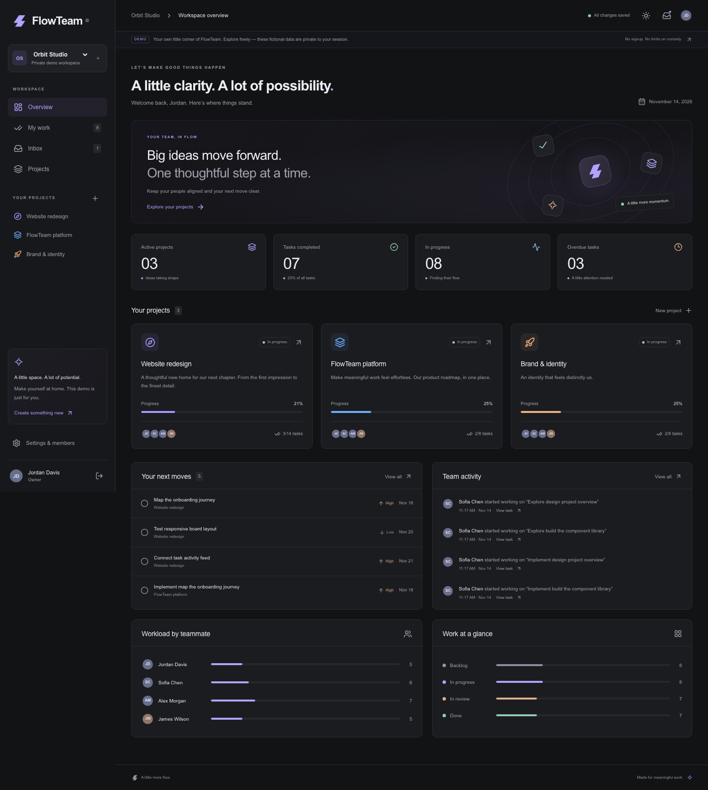
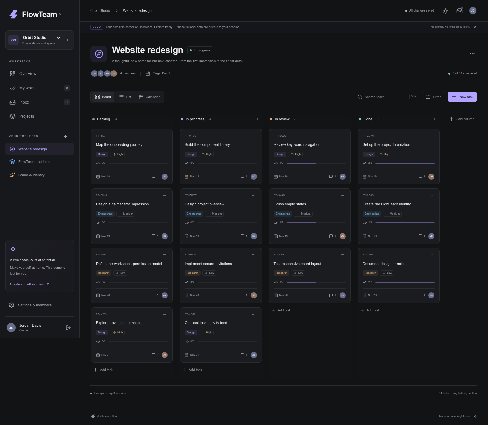
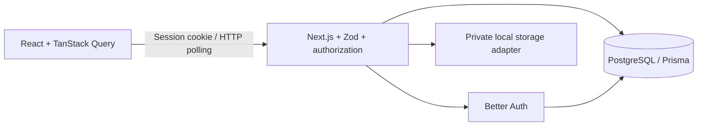

<div align="center">


# FlowTeam

**A little more clarity. A lot more flow.**

A working collaborative project workspace with private interactive demos, persistent boards and server-enforced tenant boundaries.

Next.js · React · TypeScript · PostgreSQL · Prisma · Better Auth

[**Explore the live demo →**](https://flowteam-ten.vercel.app) · [GitHub](https://github.com/cristoferdiazalvarez/flowteam) · [CI results](https://github.com/cristoferdiazalvarez/flowteam/actions/workflows/ci.yml)

[Architecture](docs/ARCHITECTURE.md) · [API](docs/API.md) · [Data model](docs/DATA_MODEL.md) · [Verification](docs/TESTING.md) · [Case study](docs/CASE_STUDY.md)

</div>



## Why FlowTeam

Project management is more than moving cards. FlowTeam connects a focused overview, real project progress, task context and team permissions. Its demo is a real workspace created for each visitor: make changes, add comments and explore without affecting somebody else's data.

**Resumen en español:** plataforma colaborativa funcional, desarrollada y probada en local, con autenticación, workspaces aislados, roles, proyectos, Kanban persistente, comentarios, adjuntos privados y métricas calculadas desde PostgreSQL. Publicado en GitHub y desplegado por HTTPS en Vercel Hobby con una base Neon Free independiente. Verificado con pruebas reales en producción; consulta los resultados y límites en docs/TESTING.md y docs/DEPLOYMENT.md. La demo contiene datos ficticios claramente identificados.

## What works

- Registration, login/logout, persistent sessions and workspace onboarding through Better Auth; passwords are hashed by the library.
- Multiple workspaces, OWNER/ADMIN/MEMBER authorization, named teams and descriptive project membership. Every workspace member can see that workspace's projects.
- Secure single-use invitation links, expiration and revocation. Local link delivery is explicitly labeled; no email is sent.
- Project creation/editing, icon/color/status, dates, member selection, archiving/restoring and confirmed deletion.
- Custom workflow columns, including configurable completion stages; task creation/editing/deletion, persistent ordering and dnd-kit pointer/keyboard movement.
- Board, list and month calendar; search and filters for priority, assignee, status, label and due date.
- Markdown task descriptions, multiple assignees, labels, checklist subtasks, comments, history and permission-protected shareable links.
- Private attachments with authenticated downloads and content/type/size checks. Vercel uses bounded PostgreSQL blobs (1 MiB/file, 5 MiB/workspace, 100 MiB total); local filesystem storage remains available.
- Near-real-time HTTP polling, optimistic board movement with rollback, task version conflicts, and idempotency keys for comment retries.
- User inbox, real project/task/overdue metrics, assignment workload and recent activity.
- Private, editable demo per visitor, with fictional teammates/projects/tasks/comments. Demo accounts are internal guest identities; no registration form or card is required.
- Original SVG identity, responsive sidebar and mobile board, dark/light tokens, reduced motion, skeletons, empty/error states, toasts, destructive confirmations and focus-trapped dialogs.



## Run locally

Tested on this Mac with **Node 26.5.0**, npm 11.17.0 and embedded **PostgreSQL 18**. Node 24 LTS is the CI target. The embedded database package is a development convenience and currently uses a beta release. Docker and a system PostgreSQL installation are unnecessary.

For this already prepared checkout:

```bash
cd ~/Desktop/FlowTeam
npm run local
```

Open **http://127.0.0.1:3000** and choose **Explorar demo** or register. `npm run local` preserves existing data, starts the project-owned database, applies checked-in migrations, runs the idempotent showcase seed and starts Next.js. Ctrl+C stops its own app/database processes. It does not stop unrelated applications.

For a fresh checkout:

```bash
npm ci
npm run local
```

Setup generates random ignored `.env` secrets if none exist. If a Prisma engine/client generation is required after installation, run `npx prisma generate`; `npm run build` also generates the client. If your package manager blocks dependency lifecycle scripts, review the listed Prisma and embedded-PostgreSQL packages rather than enabling arbitrary scripts globally.

Manual process control, when needed:

```bash
npm run setup          # generate .env once, preserving an existing file
npm run db:start       # terminal 1: isolated 127.0.0.1:55437 PostgreSQL
npm run db:migrate    # terminal 2: apply committed migrations
npm run db:seed       # idempotent showcase seed, no shared login password
npm run dev           # development app
```

Use `127.0.0.1`, not `localhost`, so authentication origins match. If port 3000 or 55437 is in use, inspect and stop only the existing FlowTeam process you own; do not kill unrelated services. Runtime data lives in `.data/postgres`; attachment bytes live in `.storage`. Both are ignored. There is no destructive reset script.

For production mode locally, keep the database running and use `npm run build && npm run start`. This was the mode used for integration and browser verification.

## Configuration

| Variable             | Purpose                                                                                       |
| -------------------- | --------------------------------------------------------------------------------------------- |
| `DATABASE_URL`       | PostgreSQL URL. The local helper uses loopback port 55437 and randomly generated credentials. |
| `BETTER_AUTH_SECRET` | Random 32+ byte signing secret; local setup generates 40 bytes.                               |
| `BETTER_AUTH_URL`    | Exact app origin, `http://127.0.0.1:3000` locally; HTTPS origin when publishing.              |

See [.env.example](.env.example). Never commit secrets or reuse local credentials in a hosted environment. No paid plan, mail provider, separate storage service or Stripe integration is needed. Hosted PostgreSQL and Vercel environment credentials stay outside the repository.

## Stack and structure

| Layer        | Implementation                                                                                                |
| ------------ | ------------------------------------------------------------------------------------------------------------- |
| App          | Next.js 16 App Router, React 19, strict TypeScript                                                            |
| Interface    | Tailwind CSS 4 pipeline, original CSS tokens, Lucide icons, accessible reusable components, Sonner            |
| Data         | PostgreSQL 18, Prisma 7.10.1 + PostgreSQL driver adapter, versioned SQL migration and seed                    |
| Identity     | Better Auth, Prisma adapter, database sessions and auth rate limits                                           |
| Validation   | Zod schemas plus tenant/resource checks on the server                                                         |
| Client state | TanStack Query, foreground polling and optimistic cache rollback                                              |
| Board        | dnd-kit pointer/keyboard sensors and transactionally persisted ordering                                       |
| Verification | Vitest, PostgreSQL/API integration tests, Playwright Chromium desktop/mobile                                  |
| Delivery     | Public GitHub repository, lockfile and GitHub Actions workflow; current execution evidence in docs/TESTING.md |

```text
app/                  Next pages, layouts, loading/error states and API routes
components/           app shell, reusable UI, board, forms and data views
lib/                  auth, Prisma, validation, services, storage and typed client contracts
prisma/               normalized schema, checked-in migration, idempotent seed
scripts/              isolated database, one-command local startup, dry-run maintenance
tests/               unit, PostgreSQL integration and desktop/mobile E2E
docs/                architecture, API, security, case study, deployment and screenshots
```



Read [architecture](docs/ARCHITECTURE.md) for concurrency, ordering, polling costs and access boundaries. Read [the data model](docs/DATA_MODEL.md) for entities and constraints.

## Verification

With PostgreSQL and the production app running:

```bash
npm run check                 # lint, strict TypeScript and unit tests
npm run build                 # generate Prisma client and production build
npm run test:integration      # real HTTP + PostgreSQL, creates/cleans its own fixtures
npx playwright install chromium
npm run test:e2e              # desktop + mobile, screenshots and two-session collaboration
npm audit --audit-level=moderate
```

Local verification passes 6 unit tests, 12 real PostgreSQL/API integration tests and 11 E2E scenarios with no mobile skips. The public HTTPS origin also passes all 11 E2E scenarios, including distinct users and different session cookies. GitHub Actions has completed successfully. See [TESTING.md](docs/TESTING.md) for exact coverage and evidence. Browser tests intentionally respect Better Auth's per-IP sign-up throttle, so account-heavy cases pause between scenarios. E2E creates isolated fixture workspaces and leaves them available locally for inspection. Integration tests delete only their own fixtures. Browser traces/reports are ignored because they can contain temporary session data.

CI is prepared in [.github/workflows/ci.yml](.github/workflows/ci.yml), with a PostgreSQL 18 service, Node 24, build, audit, integration and browser checks. GitHub publication is authorized; see the verification record for actual remote CI results.

## Security and limits

See [SECURITY.md](docs/SECURITY.md) for implemented protections and explicit boundaries. Tenant checks are server-side, task links grant no access, invite tokens are hashed, descriptions avoid raw HTML and files are downloaded only after a membership check. All metrics shown as metrics come from persisted data; decorative illustration is not historical performance data.

Current limitations:

- Collaboration is polling with approximately 3-second foreground latency, not instant push. No presence indicators or simultaneous text coediting.
- Checklist subtasks have completion state; there is no nested task hierarchy, recurring tasks or offline editing.
- All workspace projects are visible to workspace members; project participation is not an additional privacy boundary.
- Email verification/password recovery, MFA and actual email invitation delivery are not connected.
- Snapshots are unpaginated; broad public traffic needs narrower queries, abuse controls, request budgets and retention scheduling.
- Hosted attachments use private PostgreSQL bytea storage with atomic quotas. This is a small-demo design, not an object store for large files; it consumes the same free database storage and transfer limits.
- Task content/movement/deletion use version checks. Administrative settings and checklist completion use small last-write-wins updates.
- Production HTTPS and remote CI are recorded separately from local results in docs/TESTING.md; do not infer a result from prepared configuration.

`npm run maintenance` is dry-run only. Review the [retention rules](docs/SECURITY.md) before explicitly using `npm run maintenance -- --apply`.

## Screenshots and portfolio

Screenshots linked here are actual public HTTPS browser captures generated by Playwright, with fictional demo data and no real customer information.

| Screen                 | Evidence                                                                                                                                                                                |
| ---------------------- | --------------------------------------------------------------------------------------------------------------------------------------------------------------------------------------- |
| Welcome                | [Desktop](docs/screenshots/production/desktop-welcome.png) · [Mobile](docs/screenshots/production/mobile-welcome.png)                                                                   |
| Overview               | [Desktop](docs/screenshots/production/desktop-overview.png) · [Mobile](docs/screenshots/production/mobile-overview.png)                                                                 |
| Kanban                 | [Desktop](docs/screenshots/production/desktop-board.png) · [Mobile](docs/screenshots/production/mobile-board.png)                                                                       |
| Task conversation      | [Desktop](docs/screenshots/production/desktop-task.png) · [Mobile](docs/screenshots/production/mobile-task.png)                                                                         |
| Light theme            | [Desktop](docs/screenshots/production/desktop-light.png) · [Mobile](docs/screenshots/production/mobile-light.png)                                                                       |
| Tablet                 | [Overview](docs/screenshots/production/tablet-overview.png) · [Board](docs/screenshots/production/tablet-board.png) · [Light board](docs/screenshots/production/tablet-light-board.png) |
| Second browser session | [Collaboration evidence](docs/screenshots/production/desktop-collaboration-session-two.png)                                                                                             |

[Interview case study](docs/CASE_STUDY.md) · [Portfolio copy and LinkedIn draft](docs/PORTFOLIO.md)

## Publishing later

[DEPLOYMENT.md](docs/DEPLOYMENT.md) records the authorized Vercel Hobby + independent Neon Free release. It records official plan limits checked on 2026-11-14, explains polling consumption and the private-storage prerequisite, and lists the explicit approval needed to create resources or publish. Repository: https://github.com/cristoferdiazalvarez/flowteam. Nothing has been posted to LinkedIn.

## Roadmap

1. Paginated snapshots/event cursors, idle backoff and stricter public demo budgets.
2. File scanning policy and larger object storage only if future requirements justify it.
3. Email verification, recovery and invitation delivery.
4. Maintain verified CI and HTTPS release evidence.
5. Optional presence, richer subtask hierarchy and event-driven collaboration after measuring real usage.

FlowTeam is independent of BusinessOS, Atelier Commerce and Developer Portfolio. Those projects were not modified.
