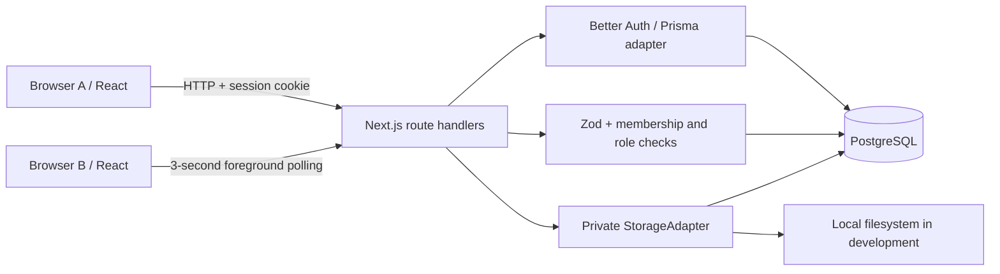

# Architecture

FlowTeam is a isolated local development setup for a conventional hosted SaaS architecture. Business data lives in real PostgreSQL, not browser storage. Only the theme preference is stored in localStorage. The interface is English; the requested public demo action is labeled “Explorar demo”.

## Application boundaries

- `app/api/auth/[...all]`: Better Auth sign-up, password hashing, login, persistent sessions, logout and database-backed auth rate limits. No homegrown password crypto.
- `app/api/data`: authenticated tenant snapshots and validated commands. Origin checks guard mutations; cookies are managed by Better Auth. Explicit `workspaceId` is checked against the session user before accessing a tenant.
- `lib/service.ts`: reusable membership, management and tenant-qualified project/task lookups. OWNER/ADMIN manage projects, columns, teams, settings, labels and invitations. MEMBER collaborates on tasks, comments, checklists and attachments. Only OWNER changes MEMBER/ADMIN roles. Ownership cannot be removed through the role command.
- `lib/demo.ts`: transactional, private demo workspace creation with fictional teammates, real persisted tasks, labels, comments and activity.
- `components/`: modular app shell, board, forms, views and accessible reusable dialogs. TanStack Query synchronizes authoritative snapshots; dnd-kit offers pointer and keyboard sorting. Task status can also be changed in the edit form.
- `lib/storage.ts`: private adapter contract; validated uploads and authenticated download handler. No static public upload directory.

All workspace members can see all projects in their workspace. Project/team member lists represent participation, **not** additional privacy boundaries. A task link grants no access. The complete tenant snapshot is appropriate for this small portfolio app; large datasets need pagination and narrower endpoints.

## Synchronization and consistency

The client refetches the authenticated snapshot every 3 seconds while the page is in the foreground and on focus. This is near-real-time HTTP polling, not push or instant synchronization. No connection state is stored in a function instance. It works across multiple Next instances and requires only PostgreSQL. Polling stops in hidden tabs through TanStack Query's default focus handling. Network query retries are bounded; mutations are not automatically replayed.

Task edits, deletion and movement require the last observed `version`. An atomic conditional update increments the version; a stale edit returns HTTP 409. The edit form retains its initial version and warns when polling detects a newer one, requiring a reload rather than silently replacing entered text. This is optimistic concurrency, not text merging or a CRDT.

Task ordering is serialized using a PostgreSQL project-row lock inside a transaction. The server validates the target column and neighboring card, calculates a midpoint, then rebases positions to multiples of 1024 under that lock to avoid floating point exhaustion. Same-column and cross-column moves persist. A client cache snapshot supports optimistic movement and rollback; authoritative data is refetched after success or failure. Reordering another card changes position but not task content version.

Comment requests carry a client-generated UUID. Replaying a completed request with the same UUID returns the original comment, after verifying its author and task. The UI retains that key for a retry after a network error. Concurrent unique-key races can return 409; retrying the same key is safe. Task/project creation is not automatically retried; after ambiguous network failure inspect the refreshed view before creating again.

Invitation tokens are 256-bit random values. Only SHA-256 hashes are stored. Acceptance atomically claims an unrevoked, unused, unexpired invitation and upserts membership. Links expire in 7 days and are single-use. Invitations do not send email in this version.

## Metrics

Counts are derived from persisted tasks and configured completion columns. “In progress” counts tasks in each project's second column, the default active stage. Completed/overdue exclude or include tasks using the explicit completion flag. Project progress is completed/total tasks. Workload counts unfinished assignments; multiple assignees count once for each person. Status bars aggregate actual column names. No random historical charts or invented growth percentages are displayed. Banner orbital artwork is decorative.

## Local development isolation

`embedded-postgres` starts PostgreSQL 18 under `.data/postgres` on `127.0.0.1:55437`; it does not install a system service, require Docker, or change other projects. Credentials are generated randomly into ignored `.env`. The setup script preserves an existing environment. On CI a PostgreSQL service runs the same checked-in migrations. Remote PostgreSQL can use the same Prisma schema.

## Tradeoffs and next steps

Full snapshots favor simplicity over bandwidth and query efficiency. Add event cursors, ETags and pagination before wider public use. Presence, offline changes, rich-text coediting, recurring tasks and email delivery are not implemented. Markdown supplies safe formatted descriptions. Checklist items are the current subtask representation; there is no nested task hierarchy.

Deployment stores private attachment bytes in PostgreSQL with an advisory lock around quota reservations (1 MiB/file, 5 MiB/workspace, 100 MiB globally). This keeps the demo within a bounded part of the free database storage allowance without another provider; database compute/transfer still apply. Add scheduled demo/session/rate-limit retention, monitoring and external abuse protection before broadly advertising an anonymous demo. See [security](SECURITY.md) and [deployment](DEPLOYMENT.md).
