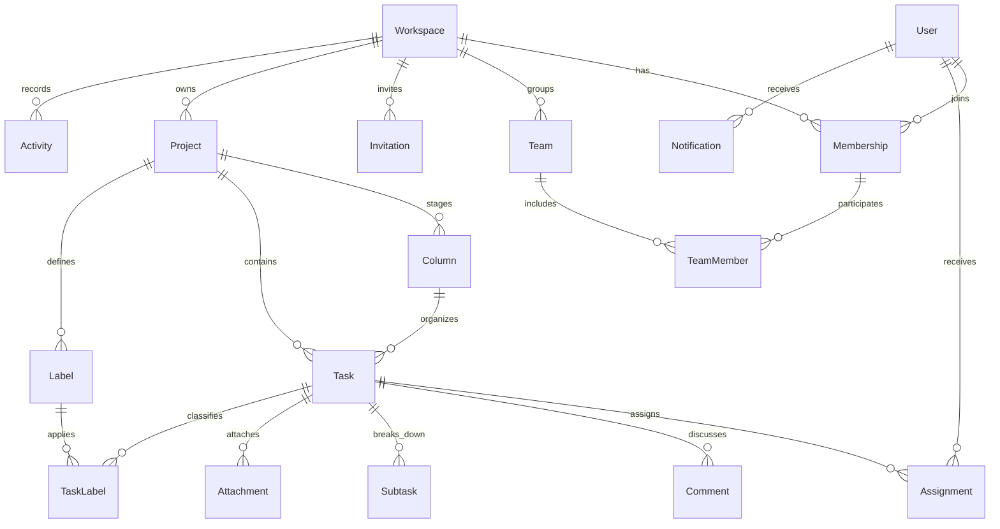

# Data model

Source of truth: [Prisma schema](../prisma/schema.prisma) and checked-in SQL migrations.

| Entity                                              | Purpose and constraints                                                                                                                                                 |
| --------------------------------------------------- | ----------------------------------------------------------------------------------------------------------------------------------------------------------------------- |
| User, Account, Session, Verification, AuthRateLimit | Better Auth identity, hashed passwords, expiring sessions and throttling; unique email/session token.                                                                   |
| Workspace                                           | Tenant boundary; demo flag; creation timestamp.                                                                                                                         |
| Membership                                          | One user/workspace pair, unique composite key; OWNER/ADMIN/MEMBER.                                                                                                      |
| Team, TeamMember                                    | Named workspace groups; unique workspace/name and team/membership pair.                                                                                                 |
| Invitation                                          | Unique hashed token, role, expiration, revoked flag and consumed timestamp.                                                                                             |
| Project, ProjectMember                              | Workspace-owned planning space and descriptive participant list; icon, color, dates, status and archive flag.                                                           |
| Column                                              | Project-owned workflow stage; unique project/position and completion flag.                                                                                              |
| Task                                                | Project/column, title, Markdown description, priority, sortable position, version, creator, timestamps and due date.                                                    |
| Assignment                                          | Unique task/user pair.                                                                                                                                                  |
| Label, TaskLabel                                    | Unique project/name; unique task/label pair.                                                                                                                            |
| Comment                                             | Author, task, body, timestamp; client UUID supports safe completed retries.                                                                                             |
| Subtask                                             | Checklist item with title and completion boolean; task-owned.                                                                                                           |
| Attachment                                          | Task-owned metadata; unique opaque storage key, byte count and sanitized name.                                                                                          |
| StorageBlob                                         | Private bytea content, owning workspace, size/content constraint and creation date. Binary data is excluded from workspace snapshots; Vercel uses this bounded adapter. |
| Activity                                            | Workspace-owned event with actor and optional task reference. Task id is a historical link, not a cascading foreign key.                                                |
| Notification                                        | User- and workspace-qualified inbox entry, read flag and timestamp.                                                                                                     |
| RateLimit                                           | Database-backed command/upload/bootstrap counters and reset deadline.                                                                                                   |

Indexes support membership lookups, workspace projects, task ordering by project/column/position, due dates, task comments, recent tenant activity and user notifications. Foreign keys and cascading deletes remove dependent business rows. The API separately verifies that task columns/labels belong to the task's project and assignees/members belong to the workspace; existence alone does not prove tenant access.

A workspace delete cascades its project data and memberships. Users can belong to multiple workspaces and are not cascade-deleted with one workspace. Task deletion removes attachment metadata; physical file garbage collection is handled by the explicit maintenance command, rather than unsafe transactional filesystem deletion.

